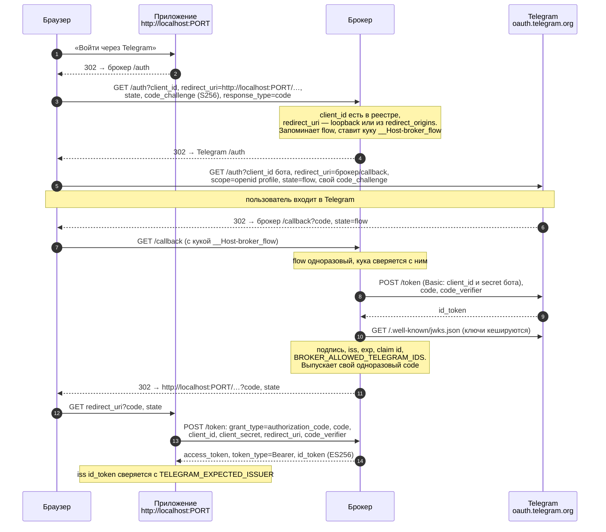
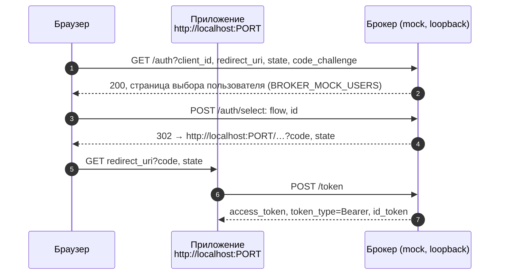

# telegram-login-broker

Постоянный публичный URL для входа через Telegram — чтобы локально разрабатывать
приложения на `http://localhost:<любой порт>` без ngrok и без походов в BotFather.

Telegram принимает только публично-резолвимые HTTPS-адреса. Брокер регистрируется
в BotFather **один раз**, а дальше сам редиректит браузер на любой локальный порт:
про новые проекты и порты Telegram не узнаёт ничего.

Умеет два режима: `mock` (офлайн, список тестовых пользователей — только loopback)
и `telegram` (настоящий вход). Плюс релей вебхуков, чтобы проверять webhook-путь
локально.

**Статус:** фазы 1–4 сделаны — брокер работает, оба потребителя переведены на
строгие проверки и на него настроены. Против **настоящего** Telegram ничего не
проверялось: нет кредов и деплоя. Релей вебхуков и MCP — фазы 6 и 7.

Проверено только против собственного mock-режима и против стаба Telegram в
тестах. С живым `oauth.telegram.org` не работал ещё ни один вход.

## Как проходит вход

Приложение работает с брокером как с OIDC-провайдером (authorization code + PKCE).
Брокер ведёт со своей стороны отдельный OIDC-вход у Telegram: свой `state`, свой
PKCE и единственный `redirect_uri` — `<брокер>/callback`. Порт приложения Telegram
не видит, его видит только брокер.



В mock-режиме Telegram нет: вместо него брокер показывает страницу выбора
тестового пользователя из `BROKER_MOCK_USERS`. Начало и конец те же —
`GET /auth` и `POST /token`.



Схемы для релея вебхуков пока нет: он запланирован на фазу 6 и в коде ещё не
появился.

## Быстрый старт, mock

Ничего от Telegram не нужно: mock не ходит наружу и стартует только на loopback.

```sh
go build -o broker ./cmd/broker

BROKER_ISSUER=http://127.0.0.1:8099 \
BROKER_BIND=127.0.0.1:8099 \
BROKER_MOCK=true \
BROKER_MOCK_USERS='[{"id":987654321,"name":"Пётр","username":"petr"}]' \
BROKER_REGISTRY_PATH=./registry.json \
BROKER_REGISTRY_KEY="$(head -c 32 /dev/urandom | base64 | tr '+/' '-_' | tr -d '=')" \
BROKER_CLIENTS='{"kotlin-app":{"secret":"app-secret"}}' \
./broker
```

Дальше приложению достаточно `TELEGRAM_OAUTH_BASE_URL=http://127.0.0.1:8099`.

**Id мок-пользователей должны совпадать с настоящими Telegram ID** — иначе
локальные данные не сойдутся с боевыми.

## Настройки

Всё, что здесь, читается **только на старте**. Боты, приложения и slug'и живут в
реестре и в фазе 7 будут меняться на лету; «кто вообще может войти» и «включён ли
mock» остаются здесь намеренно — до них админский интерфейс не достаёт.

| переменная | |
|---|---|
| `BROKER_ISSUER` | публичный адрес брокера. **Не должен содержать `telegram`** — иначе подмена провайдера проходит молча |
| `BROKER_BIND` | `host:port`, по умолчанию `:8080` |
| `BROKER_REGISTRY_PATH` | файл реестра, по умолчанию `/data/registry.json` |
| `BROKER_REGISTRY_KEY` | 32 байта base64url — ключ шифрования секретов в реестре |
| `BROKER_SIGNING_KEY` | PEM EC-ключа подписи. Без него — эфемерный на каждый старт; **сломанный не откатывается в эфемерный, а роняет старт** |
| `BROKER_MOCK` | `true` включает mock. Старт запрещён при не-loopback bind |
| `BROKER_MOCK_USERS` | JSON-массив `{id,name,username,photo_url}` |
| `BROKER_BOT_CLIENT_ID` / `BROKER_BOT_CLIENT_SECRET` | креды логин-бота из BotFather (**Login Widget**). Половина пары — фатальна |
| `BROKER_BOT_NAME` | имя бота в реестре, по умолчанию `default` |
| `BROKER_CLIENTS` | JSON: `{"<client_id>":{"secret":"…","bot":"…","redirect_origins":["https://…"]}}` |
| `BROKER_ALLOWED_TELEGRAM_IDS` | список через запятую. Пусто = без ограничения |
| `BROKER_VERIFY_ID_TOKEN` | по умолчанию `true`. `false` — аварийный выключатель проверки подписи Telegram |
| `BROKER_ID_TOKEN_TTL` | по умолчанию `5m` |

Пока нет MCP (фаза 7), приложения регистрируются только через `BROKER_CLIENTS` и
рестарт: файл реестра руками не поправить, секреты в нём зашифрованы.

## Настоящий Telegram

1. В BotFather у бота: **Login Widget** → Allowed URLs → добавить
   `https://<брокер>/callback`. Один раз на бота, дальше никогда.
2. Оттуда же взять Client ID и Client Secret.
3. Запустить без `BROKER_MOCK`, с `BROKER_BOT_CLIENT_ID` / `BROKER_BOT_CLIENT_SECRET`.

Алгоритм подписи выбирается там же (**Advanced**) и по умолчанию RS256. `EdDSA` и
`ES256K` ограничены scope `openid` и с `profile` не выдаются; `ES256K` брокер
проверить не может и явно откажет — secp256k1 нет в stdlib Go.

## Эндпоинты

`GET /auth` · `POST /auth/select` (только mock) · `GET /callback` (только telegram)
· `POST /token` · `GET /healthz` · `GET /.well-known/jwks.json` · `GET /`

Дискавери-документ **не отдаётся**: его `issuer` обязан совпадать с origin
документа, а у брокера он намеренно другой. JWKS — факт, его отдаём.

## Как потребитель переключается на брокер

Двумя переменными, которые меняются **вместе**:

```sh
TELEGRAM_OAUTH_BASE_URL=https://<брокер>
TELEGRAM_EXPECTED_ISSUER=https://<брокер>
```

`iss` брокера намеренно **не содержит** подстроки «telegram», а оба потребителя
после фазы 2 сверяют `iss` побайтово с `expected-issuer` (дефолт —
`https://oauth.telegram.org`). Поэтому подсунуть брокер приложению, которое под
него не настроено, нельзя: токен отлетит на проверке issuer.

Зафиксировано в `contract_test.go`: эталонный строгий потребитель прогоняется по
реальному выводу `/token`. Один тест проверяет, что с issuer'ом брокера токен
читается и даёт правильную личность; второй — что с дефолтным issuer'ом Telegram
тот же токен отвергается.

## Docker

```sh
docker build -t telegram-login-broker:dev .
```

`distroless/static`, а не `scratch`: в `scratch` нет корневых сертификатов, и
образ работал бы в mock-режиме идеально, а против настоящего Telegram падал бы на
TLS. Реестр лежит в `/data` — это том, и без него конфигурация умрёт на первом
редеплое.

Для локальной разработки удобно поднимать брокер в mock рядом с базой одним
`compose`-файлом на стороне приложения.

### Релиз образа

CI гоняет `gofmt`, `go vet` и `go test -race` на каждый push. Образ собирается и
уезжает в GHCR **только на тег**:

```sh
git tag -a v0.1.0 -m "фаза 1: режим входа"
git push origin v0.1.0
```

Получится `ghcr.io/proshik/telegram-login-broker:0.1.0` и `:0.1` под
`linux/amd64` и `linux/arm64`. Тега `latest` нет намеренно: деплой пинит версию, а
IdP, молча катящийся вперёд, — не то, что нужно. Деплоить по digest'у или по
точной версии.

## Потребители

Брокер писался под два приложения — на Kotlin/Spring и на Go, — но ничего
специфичного для них в нём нет: подойдёт любой OIDC-клиент, умеющий
authorization code + PKCE.

Подключение: `TELEGRAM_OAUTH_BASE_URL` и `TELEGRAM_EXPECTED_ISSUER`.

## Разработка

```sh
go test ./...
go test -race ./...
```

Тесты не спят и не ходят в сеть: время везде фальшивое, Telegram — стаб.

Отдельно стоит `internal/server/contract_test.go` — эталонная реализация строгого
потребителя, прогоняемая по реальному выводу `/token`. Дрейф контракта вылезет
там, а не в браузере. Держать её в точности такой же, как разбор токена в
приложении, которое брокером пользуется: как только они разойдутся, тест
перестанет что-либо доказывать.

## Первый настоящий вход

При первом успешном обмене с Telegram в лог попадёт одна строка с **набором
claim'ов** — только имена, значения не пишутся никогда:

```
level=INFO msg="upstream id_token claim set" claims=aud,exp,iat,id,iss,… verified=true
```

Смотреть надо на одно: есть ли там `id`. Он задокументирован на
`core.telegram.org/widgets/login`, но отсутствует в `claims_supported`
дискавери-документа, и подтвердить его может только живой вход. Если его нет —
брокер откажет, и это правильно: `sub` — другое число, подстановка выдала бы
стабильную, правдоподобную и чужую личность.

## Лицензия

MIT — см. [LICENSE](LICENSE).
